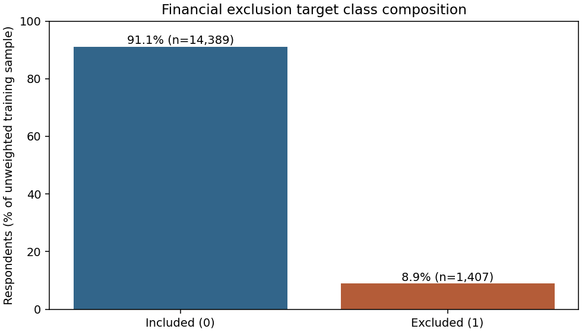
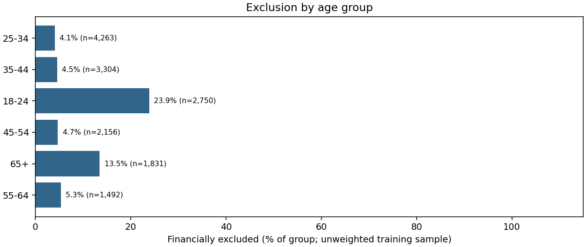
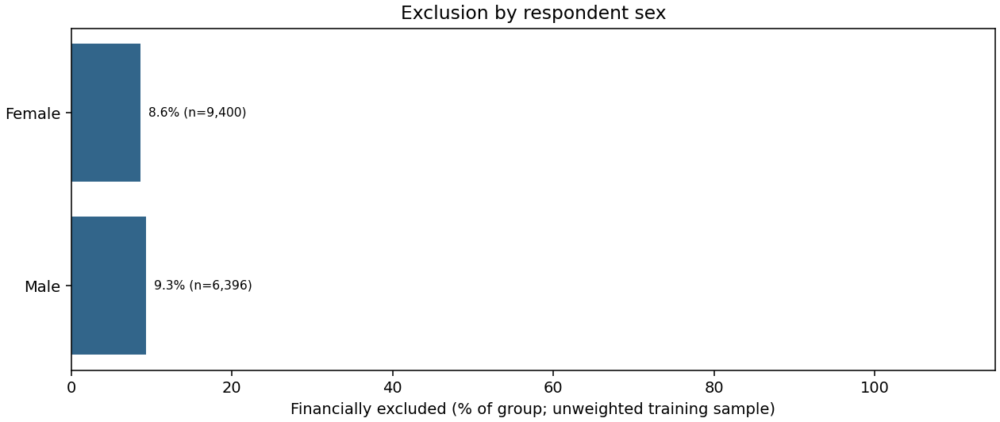
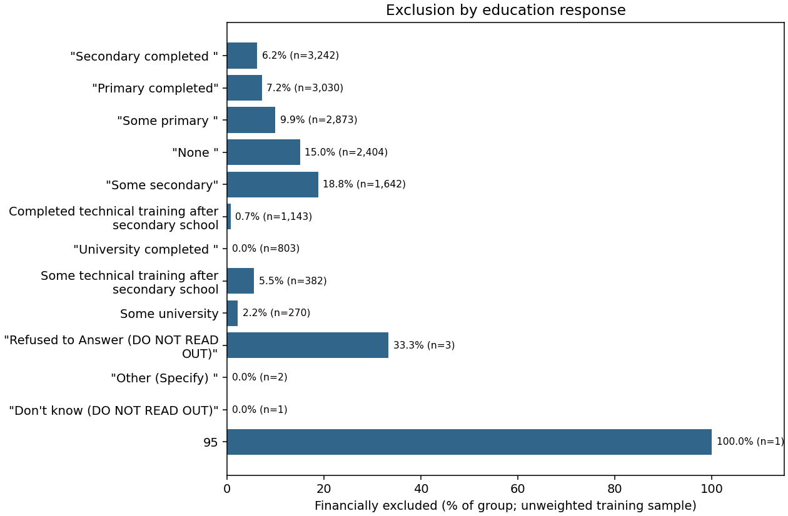
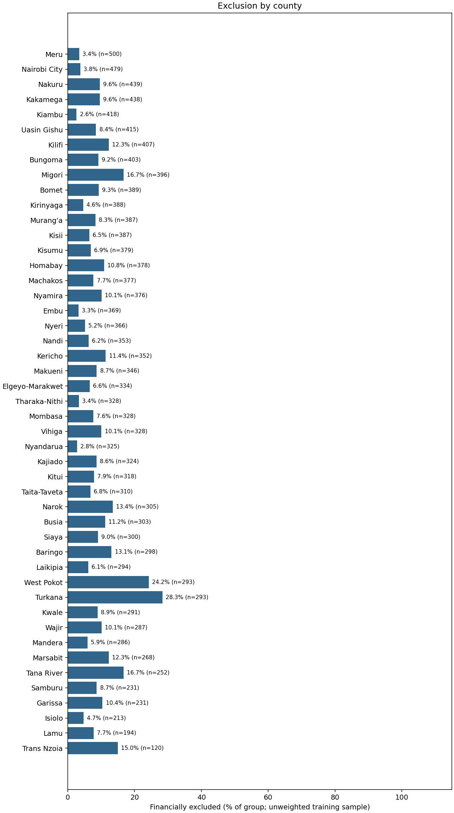
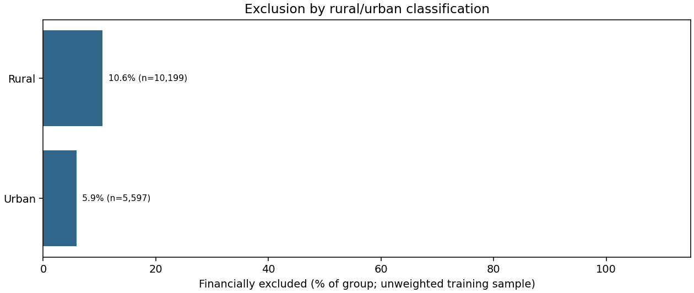

# FinAccess exploratory data analysis

## Scope and reproducibility

- Source: `finaccess_modeling_dataset_6c.parquet`; SHA-256: `1eea7fbe7d2818856e391fc8eb38bde72ef4a925c88246a94af7df5d5c06caf8`.
- Dataset: 19,746 rows and 24 columns; approved predictors: 17.
- Training partition: 15,796 adult respondents, 17 predictors and the existing binary target.
- Existing stratified 80/20 split, random seed 42; only training rows are summarized.
- All counts, percentages, associations and plots are unweighted descriptions of the training sample, not national estimates or statistical inference.
- No causal interpretation, feature selection, resampling, imputation, model fitting, or test-set analysis was performed.
- `Overall_Access_fnl` supplies the existing target; the provider's original classification derivation has not been independently verified.
- `S2__1`, `S4`, the two original outcome columns, `indWeight`, and `A07` are not predictors. Weights and the survey design were not used; PSU/strata crosswalks remain unverified.
- Group rates use all rows in each displayed group as the denominator, including explicit special/error categories; counts are not population estimates.

## Source dataset schema

These Parquet types describe the dataset schema only; non-predictor columns are not analyzed.

| column | Parquet type |
| --- | --- |
| A18 | int64 |
| Sex | string |
| A20 | string |
| county | string |
| A08 | string |
| B3A__2 | int64 |
| B3A__4 | int64 |
| B3Ii | string |
| ID_card | string |
| S1 | string |
| S3 | string |
| A24i | string |
| A24ii | string |
| A24iii | string |
| A24iv | string |
| A24v | string |
| A24vi | string |
| S2__1 | string |
| S4 | string |
| financial_exclusion_status | int8 |
| Access_fnl | string |
| Overall_Access_fnl | string |
| indWeight | double |
| A07 | int64 |

## Target class distribution

| class | respondents | percent |
| --- | --- | --- |
| Included (0) | 14389 | 91.09 |
| Excluded (1) | 1407 | 8.91 |

The training sample contains 1,407 excluded respondents (8.91%) and 14,389 included respondents (91.09%). This is a class imbalance in the sampled training data.

## Predictor data types and unusual values

Counts are raw training values. `excel_error` counts strings beginning `#`; blanks and nulls are separate. The final column counts distinct non-null source values.
`special_or_unresolved` counts only A20 `95` and B3Ii `98`/`99`; other explicit refusal/Don't know labels remain in categorical tables and are not globally recoded.
`A20=95` has no verified label; its approved preprocessing treatment as missing is not applied in these raw descriptive tables.

| field | dtype | null | blank | excel_error | special_or_unresolved | distinct_non_null |
| --- | --- | --- | --- | --- | --- | --- |
| A18 | int64 | 0 | 0 | 0 | 0 | 86 |
| Sex | object | 0 | 0 | 0 | 0 | 2 |
| A20 | object | 0 | 0 | 0 | 1 | 13 |
| county | object | 0 | 0 | 0 | 0 | 47 |
| A08 | object | 0 | 0 | 0 | 0 | 2 |
| B3A__2 | int64 | 0 | 0 | 0 | 0 | 2 |
| B3A__4 | int64 | 0 | 0 | 0 | 0 | 2 |
| B3Ii | object | 0 | 0 | 1649 | 0 | 215 |
| ID_card | object | 0 | 0 | 0 | 0 | 2 |
| S1 | object | 0 | 0 | 28 | 0 | 6 |
| S3 | object | 0 | 0 | 28 | 0 | 7 |
| A24i | object | 0 | 0 | 2 | 0 | 5 |
| A24ii | object | 0 | 0 | 1 | 0 | 5 |
| A24iii | object | 0 | 0 | 1 | 0 | 5 |
| A24iv | object | 0 | 0 | 0 | 0 | 4 |
| A24v | object | 0 | 0 | 1 | 0 | 5 |
| A24vi | object | 0 | 0 | 5 | 0 | 5 |

## Age and target

Age groups are descriptive fixed intervals, not a feature-engineering or selection decision. Group denominators and excluded counts are shown.

| age group (years) | respondents | excluded | excluded_pct |
| --- | --- | --- | --- |
| 25-34 | 4263 | 173 | 4.06 |
| 35-44 | 3304 | 150 | 4.54 |
| 18-24 | 2750 | 657 | 23.89 |
| 45-54 | 2156 | 101 | 4.68 |
| 65+ | 1831 | 247 | 13.49 |
| 55-64 | 1492 | 79 | 5.29 |

## Sex, education, and geography

County and education groups with few respondents or unusual response labels can have unstable sample percentages. Labels are preserved from the data.

## Livelihood and income

`B3A__2` and `B3A__4` are source indicators, not verified measures of current employment. Their original 0/1 values are shown without inventing meanings.
`B3Ii` is monthly income in KSh. The existing field-specific numeric conversion treats nonnumeric values, nonfinite values, and 98/99 as missing; no imputation is applied here.

| target (0 included, 1 excluded) | available | minimum | median | mean | maximum | missing_or_unresolved |
| --- | --- | --- | --- | --- | --- | --- |
| 0 | 13053 | 100.00 | 6000.00 | 11229.20 | 200000.00 | 1336 |
| 1 | 1094 | 100.00 | 2000.00 | 3437.26 | 50000.00 | 313 |

## Identification, general digital access, and functional difficulties

`ID_card` is a combined identification-document field, not national ID alone. `S1` and `S3` describe general phone/internet access or use, not financial transactions. Each A24 item is reported separately.

## All categorical predictors versus the target

Tables report raw category labels, respondent counts, excluded counts, and within-category percentages for each of the 15 approved categorical predictors.

### `Sex`

| source value | respondents | excluded | excluded_pct |
| --- | --- | --- | --- |
| Female | 9400 | 812 | 8.64 |
| Male | 6396 | 595 | 9.30 |

### `A20`

| source value | respondents | excluded | excluded_pct |
| --- | --- | --- | --- |
| "Secondary completed " | 3242 | 200 | 6.17 |
| "Primary completed" | 3030 | 217 | 7.16 |
| "Some primary " | 2873 | 284 | 9.89 |
| "None " | 2404 | 361 | 15.02 |
| "Some secondary" | 1642 | 308 | 18.76 |
| Completed technical training after secondary school | 1143 | 8 | 0.70 |
| "University completed " | 803 | 0 | 0.00 |
| Some technical training after secondary school | 382 | 21 | 5.50 |
| Some university | 270 | 6 | 2.22 |
| "Refused to Answer (DO NOT READ OUT)" | 3 | 1 | 33.33 |
| "Other (Specify) " | 2 | 0 | 0.00 |
| "Don't know (DO NOT READ OUT)" | 1 | 0 | 0.00 |
| 95 | 1 | 1 | 100.00 |

### `county`

| source value | respondents | excluded | excluded_pct |
| --- | --- | --- | --- |
| Meru | 500 | 17 | 3.40 |
| Nairobi City | 479 | 18 | 3.76 |
| Nakuru | 439 | 42 | 9.57 |
| Kakamega | 438 | 42 | 9.59 |
| Kiambu | 418 | 11 | 2.63 |
| Uasin Gishu | 415 | 35 | 8.43 |
| Kilifi | 407 | 50 | 12.29 |
| Bungoma | 403 | 37 | 9.18 |
| Migori | 396 | 66 | 16.67 |
| Bomet | 389 | 36 | 9.25 |
| Kirinyaga | 388 | 18 | 4.64 |
| Murang'a | 387 | 32 | 8.27 |
| Kisii | 387 | 25 | 6.46 |
| Kisumu | 379 | 26 | 6.86 |
| Homabay | 378 | 41 | 10.85 |
| Machakos | 377 | 29 | 7.69 |
| Nyamira | 376 | 38 | 10.11 |
| Embu | 369 | 12 | 3.25 |
| Nyeri | 366 | 19 | 5.19 |
| Nandi | 353 | 22 | 6.23 |
| Kericho | 352 | 40 | 11.36 |
| Makueni | 346 | 30 | 8.67 |
| Elgeyo-Marakwet | 334 | 22 | 6.59 |
| Tharaka-Nithi | 328 | 11 | 3.35 |
| Mombasa | 328 | 25 | 7.62 |
| Vihiga | 328 | 33 | 10.06 |
| Nyandarua | 325 | 9 | 2.77 |
| Kajiado | 324 | 28 | 8.64 |
| Kitui | 318 | 25 | 7.86 |
| Taita-Taveta | 310 | 21 | 6.77 |
| Narok | 305 | 41 | 13.44 |
| Busia | 303 | 34 | 11.22 |
| Siaya | 300 | 27 | 9.00 |
| Baringo | 298 | 39 | 13.09 |
| Laikipia | 294 | 18 | 6.12 |
| West Pokot | 293 | 71 | 24.23 |
| Turkana | 293 | 83 | 28.33 |
| Kwale | 291 | 26 | 8.93 |
| Wajir | 287 | 29 | 10.10 |
| Mandera | 286 | 17 | 5.94 |
| Marsabit | 268 | 33 | 12.31 |
| Tana River | 252 | 42 | 16.67 |
| Samburu | 231 | 20 | 8.66 |
| Garissa | 231 | 24 | 10.39 |
| Isiolo | 213 | 10 | 4.69 |
| Lamu | 194 | 15 | 7.73 |
| Trans Nzoia | 120 | 18 | 15.00 |

### `A08`

| source value | respondents | excluded | excluded_pct |
| --- | --- | --- | --- |
| Rural | 10199 | 1076 | 10.55 |
| Urban | 5597 | 331 | 5.91 |

### `B3A__2`

| source value | respondents | excluded | excluded_pct |
| --- | --- | --- | --- |
| 0 | 13781 | 1367 | 9.92 |
| 1 | 2015 | 40 | 1.99 |

### `B3A__4`

| source value | respondents | excluded | excluded_pct |
| --- | --- | --- | --- |
| 0 | 12658 | 1291 | 10.20 |
| 1 | 3138 | 116 | 3.70 |

### `ID_card`

| source value | respondents | excluded | excluded_pct |
| --- | --- | --- | --- |
| Has ID (National Identity Card (ID),Passport,Alien ID) | 14856 | 851 | 5.73 |
| No ID | 940 | 556 | 59.15 |

### `S1`

| source value | respondents | excluded | excluded_pct |
| --- | --- | --- | --- |
| I own a mobile that only I use/Nina simu ambayo ni mimi tu ninaitumia | 13332 | 409 | 3.07 |
| I don’t own a mobile phone but am able to use someone else’s phone regularly | 1061 | 414 | 39.02 |
| I don’t own or use a mobile phone/Sina wala situmii simu ya mkononi | 1009 | 543 | 53.82 |
| I own a mobile phone that both me and others use/Nina simu ya mkononi ambayo mim | 362 | 35 | 9.67 |
| #NULL! | 28 | 6 | 21.43 |
| Refused to Answer (DO NOT READ OUT)/Kataa kujibu | 4 | 0 | 0.00 |

### `S3`

| source value | respondents | excluded | excluded_pct |
| --- | --- | --- | --- |
| Never/Situmii" | 7252 | 958 | 13.21 |
| Daily/"Kila siku" | 4740 | 143 | 3.02 |
| Less ofteN/Mara kwa mara" | 1855 | 174 | 9.38 |
| Weekly/Kila wiki" | 1602 | 93 | 5.81 |
| Monthly/Mara moja kwa mwezi" | 303 | 28 | 9.24 |
| #NULL! | 28 | 6 | 21.43 |
| Refused to Answer/Kataa kujibu | 16 | 5 | 31.25 |

### `A24i`

| source value | respondents | excluded | excluded_pct |
| --- | --- | --- | --- |
| No- no difficulty | 13386 | 1191 | 8.90 |
| Yes - some difficulty | 1962 | 160 | 8.15 |
| Yes - a lot of difficulty | 431 | 48 | 11.14 |
| Cannot do at all | 15 | 6 | 40.00 |
| #NULL! | 2 | 2 | 100.00 |

### `A24ii`

| source value | respondents | excluded | excluded_pct |
| --- | --- | --- | --- |
| No- no difficulty | 15020 | 1285 | 8.56 |
| Yes - some difficulty | 644 | 97 | 15.06 |
| Yes - a lot of difficulty | 128 | 22 | 17.19 |
| Cannot do at all | 3 | 2 | 66.67 |
| #NULL! | 1 | 1 | 100.00 |

### `A24iii`

| source value | respondents | excluded | excluded_pct |
| --- | --- | --- | --- |
| No- no difficulty | 14206 | 1224 | 8.62 |
| Yes - some difficulty | 1154 | 120 | 10.40 |
| Yes - a lot of difficulty | 421 | 58 | 13.78 |
| Cannot do at all | 14 | 5 | 35.71 |
| #NULL! | 1 | 0 | 0.00 |

### `A24iv`

| source value | respondents | excluded | excluded_pct |
| --- | --- | --- | --- |
| No- no difficulty | 14986 | 1281 | 8.55 |
| Yes - some difficulty | 703 | 103 | 14.65 |
| Yes - a lot of difficulty | 103 | 22 | 21.36 |
| Cannot do at all | 4 | 1 | 25.00 |

### `A24v`

| source value | respondents | excluded | excluded_pct |
| --- | --- | --- | --- |
| No- no difficulty | 15273 | 1303 | 8.53 |
| Yes - some difficulty | 387 | 75 | 19.38 |
| Yes - a lot of difficulty | 113 | 23 | 20.35 |
| Cannot do at all | 22 | 6 | 27.27 |
| #NULL! | 1 | 0 | 0.00 |

### `A24vi`

| source value | respondents | excluded | excluded_pct |
| --- | --- | --- | --- |
| No- no difficulty | 15438 | 1319 | 8.54 |
| Yes - some difficulty | 249 | 56 | 22.49 |
| Yes - a lot of difficulty | 101 | 29 | 28.71 |
| #NULL! | 5 | 1 | 20.00 |
| Cannot do at all | 3 | 2 | 66.67 |

## Potential redundancy: descriptive associations only

Pearson correlations use pairwise available values of raw age, numeric income, and the two binary livelihood indicators; no scaling or imputation is used. Pairwise sample sizes differ.

| first | second | n | pearson_r |
| --- | --- | --- | --- |
| A18 | B3Ii | 14147 | -0.03 |
| A18 | B3A__2 | 15796 | -0.11 |
| A18 | B3A__4 | 15796 | -0.06 |
| B3Ii | B3A__2 | 14147 | 0.34 |
| B3Ii | B3A__4 | 14147 | 0.11 |
| B3A__2 | B3A__4 | 15796 | -0.11 |

The ten largest descriptive Cramer's V values across the 15 categorical predictors are shown below. Source response and Excel error tokens remain categories; null pairs are excluded. High-cardinality variables and small cells can inflate associations. These are exploratory associations, not significance tests or grounds for dropping predictors.

| first | second | n | cramers_v |
| --- | --- | --- | --- |
| S1 | S3 | 15796 | 0.47 |
| A20 | B3A__2 | 15796 | 0.39 |
| county | A08 | 15796 | 0.38 |
| A08 | S3 | 15796 | 0.38 |
| A20 | A08 | 15796 | 0.31 |
| B3A__2 | S3 | 15796 | 0.30 |
| A24iii | A24v | 15796 | 0.29 |
| ID_card | S1 | 15796 | 0.28 |
| A20 | S3 | 15796 | 0.26 |
| A24iii | A24iv | 15796 | 0.26 |

## Limitations

Results are descriptive, unweighted and cross-sectional. They cannot establish causation, national representativeness or design-corrected uncertainty. No population inference or feature-selection decision is made from these summaries.
Some category labels contain original workbook encoding artifacts; they are not silently normalized. S2/S4 routing and S2 export codes, A20=95, income error tokens, and the provider target derivation remain unresolved.
The 80/20 split is stratified by target but is not confirmed as cluster- or survey-design-aware; further design review is required.
