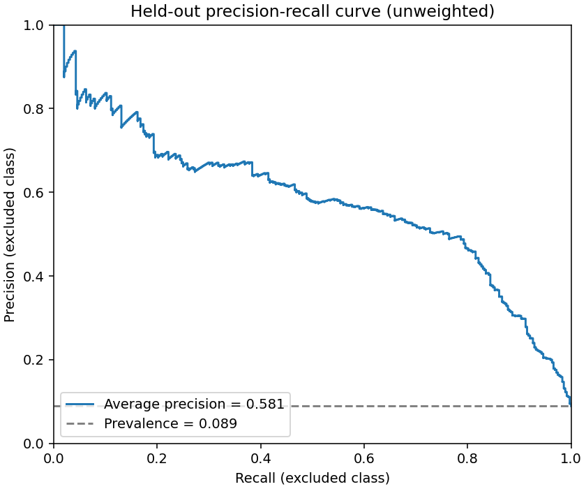

# Model training and evaluation

## Method

- Input: `finaccess_modeling_dataset_6c.parquet`; SHA-256 `1eea7fbe7d2818856e391fc8eb38bde72ef4a925c88246a94af7df5d5c06caf8`.
- Existing stratified 80/20 split (seed 42): 15,796 training and 3,950 held-out respondents.
- Five shuffled stratified training folds (seed 42); each fold fits its own existing preprocessing and estimator. No resampling or hyperparameter tuning.
- Fixed logistic regression and random forest candidates use balanced class weights. Select the highest mean training-fold F1 for excluded class 1, then recall; exact ties favor logistic regression.
- Predictions use the estimators' default 0.5 probability threshold. PR-AUC is average precision (step-weighted area); fold standard deviations use population convention (ddof=0).
- Metrics are unweighted sample descriptions; survey weights and design were not incorporated. The split and folds are not verified as cluster-aware.
- The provider's original outcome classification derivation remains unverified. These cross-sectional results are neither causal nor nationally representative.

## Training cross-validation comparison

| Model | Accuracy | Precision | Recall | F1 | ROC-AUC | PR-AUC (AP) |
| --- | --- | --- | --- | --- | --- | --- |
| logistic_regression | 0.8991 ± 0.0027 | 0.4638 ± 0.0079 | 0.8486 ± 0.0245 | 0.5997 ± 0.0089 | 0.9236 ± 0.0065 | 0.5997 ± 0.0097 |
| random_forest | 0.9300 ± 0.0020 | 0.6528 ± 0.0214 | 0.4606 ± 0.0181 | 0.5397 ± 0.0130 | 0.9174 ± 0.0084 | 0.6068 ± 0.0099 |

Selected model: **logistic_regression**, using training-fold scores only. Fold values and settings are in the adjacent JSON files.

## Selected model: held-out test evaluation

| Metric | Value |
| --- | --- |
| accuracy | 0.8952 |
| precision | 0.4513 |
| recall | 0.8153 |
| f1 | 0.5810 |
| roc_auc | 0.9226 |
| pr_auc_average_precision | 0.5811 |

Confusion matrix (rows actual, columns predicted; 0 included, 1 excluded):

| Actual / predicted | 0 | 1 |
| --- | --- | --- |
| 0 | 3249 | 349 |
| 1 | 65 | 287 |

The full classification report and metric values are in `model_evaluation.json`.

## Limitations

Recall and F1 concern the excluded class, not a population-level estimate. Threshold, model choice, and class weights require further substantive review; no test-set tuning was performed. Unresolved predictor response codes and survey design mappings remain documented in the variable selection and cleaning reports.
