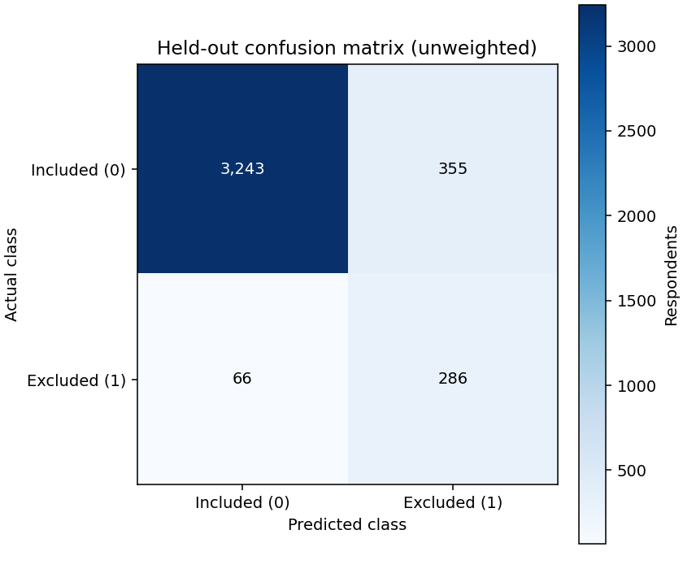
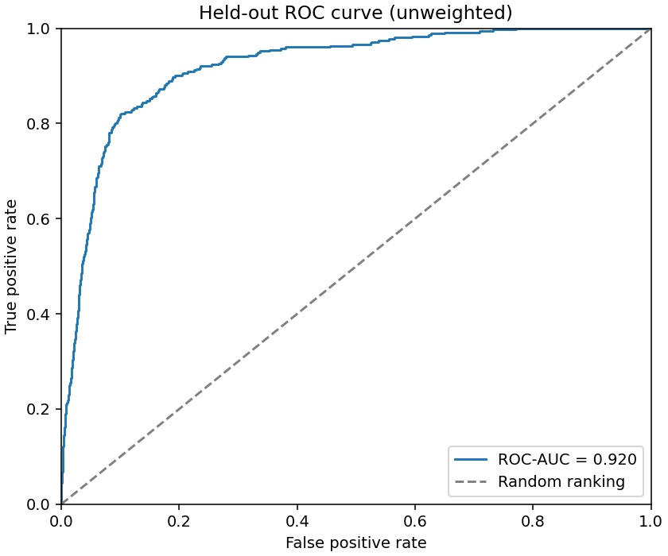

# Model training and evaluation

## Method

- Input: `finaccess_modeling_dataset_6c.parquet`; SHA-256 `1eea7fbe7d2818856e391fc8eb38bde72ef4a925c88246a94af7df5d5c06caf8`.
- Existing stratified 80/20 split (seed 42): 15,796 training and 3,950 held-out respondents.
- Five shuffled stratified training folds (seed 42); each fold fits its own existing preprocessing and estimator. No resampling or hyperparameter tuning.
- The approved proposal specifies four candidates: logistic regression (baseline), random forest (bagged trees), XGBoost (boosted trees), and an RBF support vector machine.
- Logistic regression, random forest and SVM use balanced class weights; XGBoost calculates its positive-class weight from the negative/positive ratio within each fit, including each training fold.
- Select the highest mean training-fold F1 for excluded class 1, then recall; complete ties follow the fixed order listed above. No candidate uses test results for selection.
- The selected model uses decision_function with the default decision threshold 0.0. SVM uses decision scores rather than calibrated probabilities. PR-AUC is average precision (step-weighted area); fold standard deviations use population convention (ddof=0).
- This test partition was already evaluated and its results shared in the earlier two-model Phase 8 experiment. It is reused with researcher approval and is not a pristine independent assessment of the expanded comparison.
- Metrics are unweighted sample descriptions; survey weights and design were not incorporated. The split and folds are not verified as cluster-aware.
- The provider's original outcome classification derivation remains unverified. These cross-sectional results are neither causal nor nationally representative.

## Training cross-validation comparison

| Model | Accuracy | Precision | Recall | F1 | ROC-AUC | PR-AUC (AP) |
| --- | --- | --- | --- | --- | --- | --- |
| logistic_regression | 0.8991 ± 0.0027 | 0.4638 ± 0.0079 | 0.8486 ± 0.0245 | 0.5997 ± 0.0089 | 0.9236 ± 0.0065 | 0.5997 ± 0.0097 |
| random_forest | 0.9300 ± 0.0020 | 0.6528 ± 0.0214 | 0.4606 ± 0.0181 | 0.5397 ± 0.0130 | 0.9174 ± 0.0084 | 0.6068 ± 0.0099 |
| xgboost | 0.9108 ± 0.0039 | 0.4997 ± 0.0154 | 0.7399 ± 0.0268 | 0.5964 ± 0.0170 | 0.9180 ± 0.0079 | 0.6009 ± 0.0107 |
| svm | 0.8998 ± 0.0044 | 0.4662 ± 0.0128 | 0.8515 ± 0.0209 | 0.6024 ± 0.0136 | 0.9251 ± 0.0061 | 0.5801 ± 0.0168 |

Selected model: **svm**, using training-fold scores only. Fold values and settings are in the adjacent JSON files.

## Selected model: held-out test evaluation

| Metric | Value |
| --- | --- |
| accuracy | 0.8934 |
| precision | 0.4462 |
| recall | 0.8125 |
| f1 | 0.5760 |
| roc_auc | 0.9201 |
| pr_auc_average_precision | 0.5646 |

Confusion matrix (rows actual, columns predicted; 0 included, 1 excluded):

| Actual / predicted | 0 | 1 |
| --- | --- | --- |
| 0 | 3243 | 355 |
| 1 | 66 | 286 |

The full classification report and metric values are in `model_evaluation.json`.

## Limitations

Recall and F1 concern the excluded class, not a population-level estimate. The previously examined test partition cannot provide a pristine assessment after expanding the candidate set; independent evaluation requires separately approved data or design. Threshold, model choice, and class weights require further substantive review; no test-set tuning was performed. Unresolved predictor response codes and survey design mappings remain documented in the variable selection and cleaning reports.
The fitted SVM contains transformed training observations as support vectors; keep the artifact local and do not commit it.
