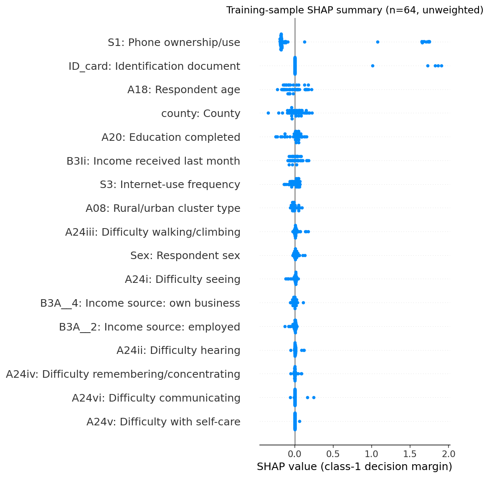
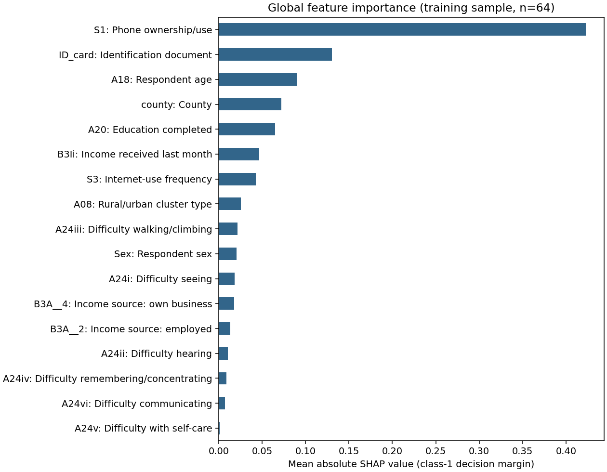
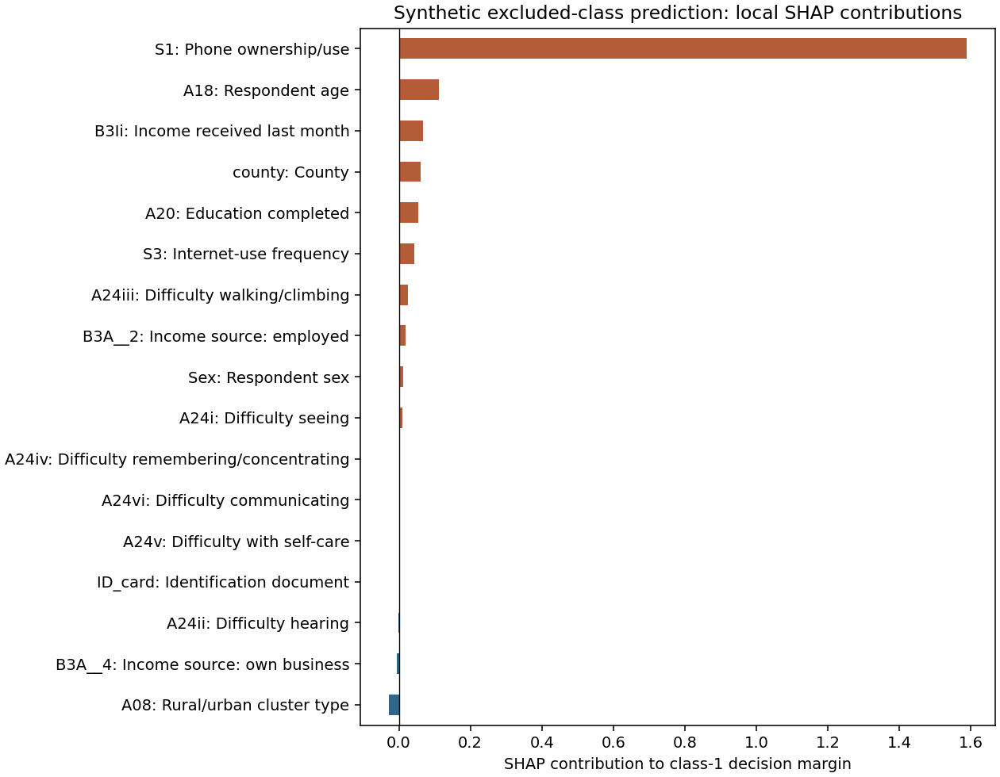

# SHAP explanations for the selected SVM

## Method and scope

- The fitted pipeline is an RBF SVC with classes `[0, 1]`, 17 approved raw inputs and 114 fitted transformed features.
- Model-agnostic `shap.KernelExplainer` explains the complete unchanged pipeline's `decision_function`, not an assumed linear model or a probability. Positive margins and positive SHAP contributions favor class 1 (excluded).
- A disjoint random sample of 24 training rows is the background; 64 other training rows form the global sample (seed 42). No test rows are used.
- Approximate Kernel SHAP uses 128 sampled coalitions per explanation, `l1_reg=0.0` and SHAP 0.49.1. Mean absolute SHAP values are unweighted sample summaries.
- Masking is performed at the original-variable level through the fitted pipeline. Thus each source variable's numeric, missing-indicator or one-hot outputs are varied together; the complete transformed-to-source mapping is in `shap_explanations.json`.
- Model SHA-256: `28157bb0ec77224bc964532e5ed3b92645115afde65a2a1e026678640a7e319b`. Dataset SHA-256: `1eea7fbe7d2818856e391fc8eb38bde72ef4a925c88246a94af7df5d5c06caf8`.
- Background mean margin: -0.9585; maximum numerical additivity residual: 4.44e-16.

## Global importance

| Original variable | Description | Mean absolute SHAP value |
| --- | --- | ---: |
| `S1` | Phone ownership/use | 0.4229 |
| `ID_card` | Identification document | 0.1302 |
| `A18` | Respondent age | 0.0897 |
| `county` | County | 0.0722 |
| `A20` | Education completed | 0.0648 |
| `B3Ii` | Income received last month | 0.0467 |
| `S3` | Internet-use frequency | 0.0429 |
| `A08` | Rural/urban cluster type | 0.0254 |
| `A24iii` | Difficulty walking/climbing | 0.0214 |
| `Sex` | Respondent sex | 0.0207 |
| `A24i` | Difficulty seeing | 0.0184 |
| `B3A__4` | Income source: own business | 0.0178 |
| `B3A__2` | Income source: employed | 0.0132 |
| `A24ii` | Difficulty hearing | 0.0103 |
| `A24iv` | Difficulty remembering/concentrating | 0.0088 |
| `A24vi` | Difficulty communicating | 0.0073 |
| `A24v` | Difficulty with self-care | 0.0010 |

## Local explanation

The local case is a synthetic composite of the per-variable modes among training rows the model predicts excluded. It is not a reported individual; the input values are not exported. Combining modes can form an implausible profile.
Its predicted class is 1 (excluded), decision margin 1.0032, and background margin -0.9585. The signed contributions in the figure and JSON sum to the difference.

## Limitations

These are model associations, not causal effects, probabilities, or nationally representative estimates. Small background and explanation samples and approximate coalition sampling can change rankings; they are not uncertainty estimates. Independently substituting background variables can create implausible combinations and does not establish conditional or causal effects. Correlated predictors can share or redistribute attribution. The model's prior held-out evaluation was already exposed, survey weights/design are not used, and the provider's target derivation remains unverified. Do not use these results to change features or tune the model based on the test set.
